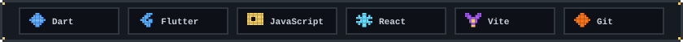
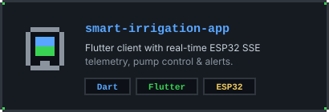
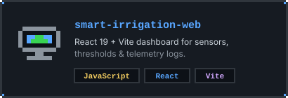
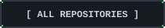
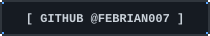

  <picture>
    <source media="(prefers-color-scheme: dark)" srcset="./assets/pixel-banner-dark.svg" />
    <source media="(prefers-color-scheme: light)" srcset="./assets/pixel-banner-light.svg" />
    
  </picture>

  <picture>
    <source media="(prefers-color-scheme: dark)" srcset="./assets/dialogue-dark.svg" />
    <source media="(prefers-color-scheme: light)" srcset="./assets/dialogue-light.svg" />
    
  </picture>

### Stack

  <picture>
    <source media="(prefers-color-scheme: dark)" srcset="./assets/stack-dark.svg" />
    <source media="(prefers-color-scheme: light)" srcset="./assets/stack-light.svg" />
    
  </picture>

### Projects

  <a href="https://github.com/Febrian007/smart-irrigation-app">
    <picture>
      <source media="(prefers-color-scheme: dark)" srcset="./assets/card-app-dark.svg" />
      <source media="(prefers-color-scheme: light)" srcset="./assets/card-app-light.svg" />
      
    </picture>
  </a>
  <a href="https://github.com/Febrian007/smart-irrigation-web">
    <picture>
      <source media="(prefers-color-scheme: dark)" srcset="./assets/card-web-dark.svg" />
      <source media="(prefers-color-scheme: light)" srcset="./assets/card-web-light.svg" />
      
    </picture>
  </a>

 

  <picture>
    <source media="(prefers-color-scheme: dark)" srcset="https://raw.githubusercontent.com/Febrian007/Febrian007/output/github-contribution-grid-snake-dark.svg" />
    <source media="(prefers-color-scheme: light)" srcset="https://raw.githubusercontent.com/Febrian007/Febrian007/output/github-contribution-grid-snake.svg" />
    
  </picture>

  <a href="https://github.com/Febrian007?tab=repositories">
    <picture>
      <source media="(prefers-color-scheme: dark)" srcset="./assets/btn-repos-dark.svg" />
      <source media="(prefers-color-scheme: light)" srcset="./assets/btn-repos-light.svg" />
      
    </picture>
  </a>
  &nbsp;
  <a href="https://github.com/Febrian007">
    <picture>
      <source media="(prefers-color-scheme: dark)" srcset="./assets/btn-profile-dark.svg" />
      <source media="(prefers-color-scheme: light)" srcset="./assets/btn-profile-light.svg" />
      
    </picture>
  </a>

