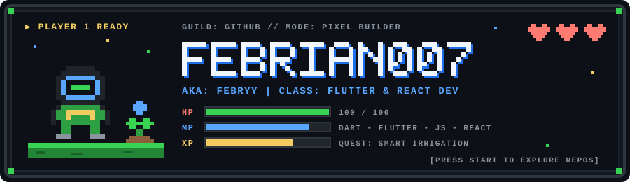
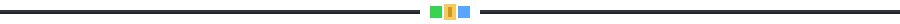

<div align="center">

<!-- PIXEL ARCADE HERO BANNER -->


<br />

<!-- TYPING PIXEL SUBTITLE -->
<a href="https://github.com/Febrian007">
  
</a>

<br />

<!-- RETRO STATUS BADGES -->


</div>

<br />

<div align="center">
  
</div>

## 🎮 `01 // CHARACTER SHEET`

```text
+-----------------------------------------------------------------------+
|  PLAYER ID   : Febrian007 (febryy)                                    |
|  GUILD       : Mobile & Web Engineering                               |
|  MAIN QUEST  : Building Smart Irrigation Ecosystem (Mobile + Web)     |
|  WEAPONRY    : Flutter • Dart • React 19 • Vite • JavaScript          |
|  ACHIEVEMENT : [YOLO] Unlocked                                        |
|  STATUS      : [ONLINE] Grinding commits & shipping builds...         |
+-----------------------------------------------------------------------+
```

<br />

## 🎒 `02 // EQUIPPED GEAR (TECH STACK)`

<div align="center">

**Primary Inventory**


<br /><br />


</div>

<br />

<div align="center">
  
</div>

## 🗺️ `03 // ACTIVE QUEST LOG (PROJECTS)`

<table>
  <tr>
    <td width="50%" valign="top">
      <h3>📱 Quest 01: <code>smart-irrigation-app</code></h3>
      <p>
        <strong>Rank:</strong> <code>MAIN QUEST</code> &nbsp;|&nbsp;
        <strong>Class:</strong> <code>Dart / Flutter</code>
      </p>
      <p>Aplikasi kontrol &amp; pemantauan sistem irigasi pintar lintas platform berbasis <strong>Flutter</strong> (Android, iOS, Web &amp; Desktop).</p>
      <a href="https://github.com/Febrian007/smart-irrigation-app">
        
      </a>
    </td>
    <td width="50%" valign="top">
      <h3>🌐 Quest 02: <code>smart-irrigation-web</code></h3>
      <p>
        <strong>Rank:</strong> <code>CO-OP QUEST</code> &nbsp;|&nbsp;
        <strong>Class:</strong> <code>JS / React + Vite</code>
      </p>
      <p>Dashboard web modern untuk sistem irigasi pintar yang dibangun dengan <strong>React 19</strong>, <strong>Vite 6</strong>, dan arsitektur modular.</p>
      <a href="https://github.com/Febrian007/smart-irrigation-web">
        
      </a>
    </td>
  </tr>
</table>

<br />

## 🐍 `04 // PIXEL CONTRIBUTION SNAKE`

<div align="center">
  <picture>
    <source media="(prefers-color-scheme: dark)" srcset="https://raw.githubusercontent.com/Febrian007/Febrian007/output/github-contribution-grid-snake-dark.svg" />
    <source media="(prefers-color-scheme: light)" srcset="https://raw.githubusercontent.com/Febrian007/Febrian007/output/github-contribution-grid-snake.svg" />
    
  </picture>
</div>

<br />

<div align="center">
  
</div>

## 🏆 `05 // ARCADE SCOREBOARD`

<div align="center">
  
  
</div>

<br />

<div align="center">
  
</div>

<br />

<div align="center">

```text
===================================================================
  [A] STAR A REPO    [B] FORK A QUEST    [START] LET'S COLLABORATE
===================================================================
```

</div>
